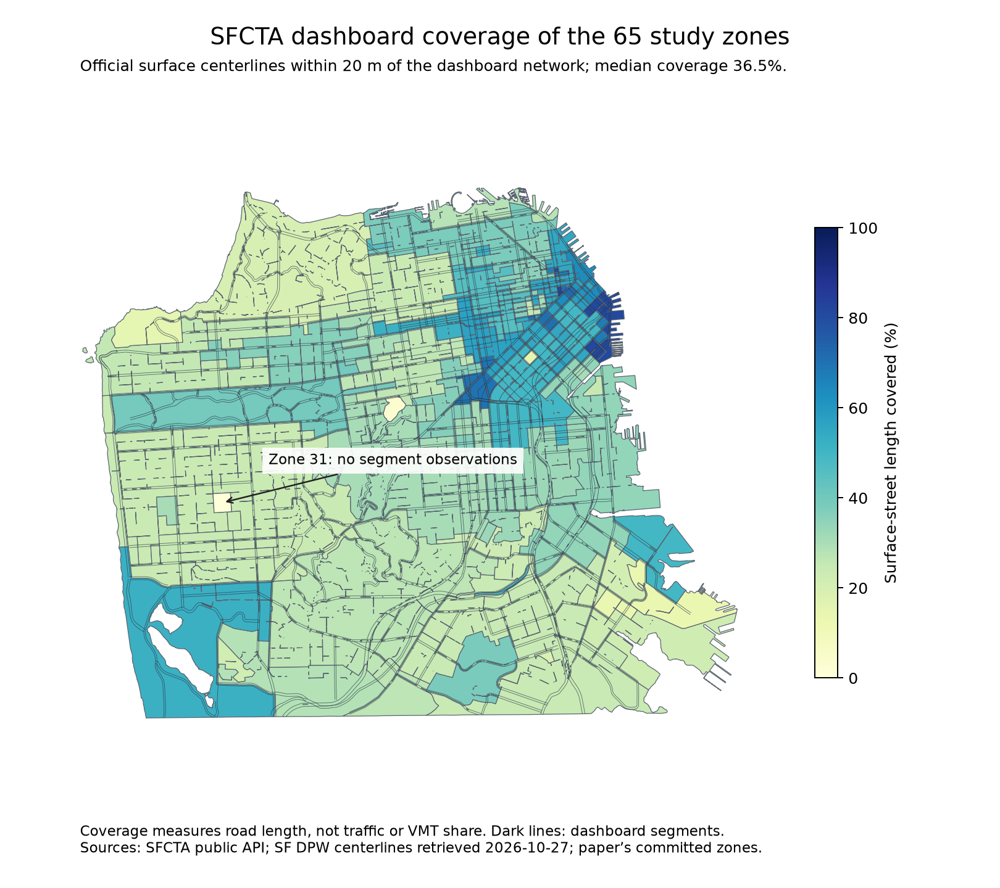

# Local data investigation for the AV crash working paper

**Category 5 update, 2026-10-29:** [Service/activity handoff](SERVICE_ACTIVITY_DELIVERY.md) is complete as a retrospective estimated-data package: 32 months of reported Waymo tract trips and 17 Cruise months allocated to zones, 23 months of changing Waymo driving activity, two alternatives for 18 recent redacted trip months, plus monthly traffic and authority-event covariates. Monthly tables cover all 65 zones across 66 months with explicit missingness; annual joins report coverage. Historical service polygons and all-operator ride requests remain unavailable observations. The older audit statements below are superseded where this handoff supplies data or estimates.

**Category 4 update, 2026-10-29:** [Refined location handoff](GEOCODING_DELIVERY.md) now provides 749/757 candidate point locations. Of the original 48 unresolved rows, 40 have point estimates, one has multiple junction candidates, one is a confirmed Atlanta/SF source conflict, and six remain unresolved. Original audit findings below are historical.

**Category 3 update, 2026-10-29:** [January–June 2026 extension](EXTENSION_2026_H1_DELIVERY.md) provides four matched-window, 65-zone Waymo/reference candidates. The Waymo-only handoff is complete; all-operator DMV deployment coverage remains unfilled.

**Category 2 update, 2026-10-29:** [AV-mileage candidates are delivered](AV_MILEAGE_DELIVERY.md), including recovered Cruise reports, operator-level testing estimates, audited Waymo reconciliation, and explicitly estimated missing periods/spatial allocation. They complete the estimated-data handoff for the paper scope; the original source limitations below are retained as historical audit findings.

**2026-10-29 update:** Category 1 is now completed as an estimated-data deliverable: two primary human-mileage candidates and three sensitivity variants cover all 65 zones for 2021–2025. See [the human-mileage delivery](HUMAN_MILEAGE_DELIVERY.md). The original audit below records the source limitations; these are now addressed through explicit estimation assumptions, rather than treated as blockers to handing off data.

Reviewed 2026-10-27. Working Overleaf project: [revised AV crash paper](https://www.overleaf.com/project/6ad68519efbdb501939650cb), cloned locally at commit `43757e8`. Analysis repository: [Nathan’s public code](https://github.com/nathanweill/Self-Driving-Car-Crash-Prediction), commit `fed7e5a2daa19cb100154ede57d61c013601e3a3`.

**The main advance is a reproducible, time-varying human-mileage proxy by zone, plus recovered Waymo mileage releases and a better documented location pipeline. A defensible, complete all-operator commercial panel is still not available.** All work is local. The original testing-only inputs, fitted results, and manuscript files are preserved.

## What Nathan needs from Bowen

The last active supplementary section, `appendix_commercial.tex`, lists five priorities: human mileage by zone; AV mileage by zone and year; 2026 DMV deployment data with matching human crashes; better crash geocoding; and time-varying service/demand covariates. The main data section supplies the definitions and geographic design that any extension must preserve. The useful deliverable is an evidence-backed data package and a plan for matching those sources—not another prose rewrite of the entire paper.

The public analysis repository contains the testing-only pipeline and 65-zone geography, but not the commercial assembly, 704-row geocoding crosswalk, or DMV–Waymo overlap matches described in the supplement. Those files are needed to compare new locations and reproduce the reported commercial results exactly.

## Initial audit results by priority, October 27

| Priority | Local result | Remaining limitation |
|---|---|---|
| Human mileage by zone | SFCTA monthly segment volumes for 2021–2025 mapped to the 65 study zones; Waymo’s 2022 HPMS benchmark mapped separately | SFCTA covers part of the network; HPMS is a static benchmark in published cells. Neither is complete observed human-only zone/year mileage. |
| AV mileage | Nine spatial snapshots recovered, ending July 2024–June 2026; cell/zone crosswalk and interval audit | Earlier years remain unresolved. Geography definitions change; some cumulative values decrease or disappear. No other-operator zone mileage recovered. |
| 2026 extension | DMV template/rule audit; provisional SF injury data through August 2026; separate January–June zone counts | No verified public deployment mileage dataset located. Reporting template lacks geographic fields; injury source differs from TIMS. |
| Crash geocoding | Official SF centerlines; 709/757 source rows given automated candidate coordinates; review queue retained | Approximate locations, zone boundaries, historical street changes, and conflicting descriptions need review. This is not a validated replacement for Nathan’s 704 matches. |
| Time-varying covariates | Monthly SFCTA traffic proxy and valid Waymo mileage intervals can describe changing traffic/activity | Neither equals ride-hailing demand or an authorized service boundary. Current tract trip counts remain redacted in the inspected CPUC files. |

## 1. Human exposure: two usable research candidates

### SFCTA: monthly coverage across 2021–2025

The [official congestion dashboard](https://congestion.sfcta.org/) publishes segment-level daily volume estimates inferred from INRIX speeds and volume-delay functions. Its public data endpoint supplied **86,805 AM/PM rows, 43,433 distinct segment-months, 739 observed segments, and all 60 months of 2021–2025**. The `year` field is always 2020; observation dates come from `date`. AM/PM rows contain the same daily volume, so the pipeline counts it once.

Segment volumes are multiplied by published segment length, apportioned by the fraction of geometry inside each zone, then multiplied by days in the month. This gives a **partial-network VMT proxy**. There are 325 zone/year rows; zone 31 has no segment observations in any of the five years, and those values remain missing.

The median share of official surface-street centerline length within 20 m of the dashboard network is **36.5%**, with a range of **0–81.1%**. This measures geometric coverage, not the proportion of traffic captured. Busy roads can carry much more traffic than their road-length share. The direct network sum also does not reproduce the dashboard’s separately calibrated citywide total; neither series is silently rescaled to the manuscript’s existing totals.

Files: [zone/year proxy](outputs/sfcta_zone_year_vmt_proxy.csv), [zone/month proxy](outputs/sfcta_zone_month_vmt_proxy.csv), [coverage](outputs/sfcta_zone_road_coverage.csv), [segment-to-zone allocation](outputs/sfcta_segment_to_zone.csv), [citywide comparison series](outputs/sfcta_citywide_year_vmt_proxy.csv).

These traffic estimates do not isolate human-operated vehicles from AVs. Before using them as the model’s human-exposure denominator, obtain full-network link volumes or a documented expansion method. [SFCTA’s Model & Data Service Bureau](https://www.sfcta.org/model-data-service-bureau) explicitly accepts requests for model outputs. A precise request is in [NEXT_STEPS.md](NEXT_STEPS.md).

### Waymo/HPMS: a static spatial benchmark

[Waymo’s Data Hub](https://waymo.com/safety/impact/) CSV4 includes annual human benchmark VMT as well as Waymo miles. Current filenames identify the **2022 benchmark**; this is not a 2021–2025 time series. The benchmark methodology concerns a defined passenger-vehicle/surface-street comparison, so its scope must be reconciled with the paper’s crash/exposure definitions.

The June 2026 file has **134 SF cells** and **1.285 billion benchmark annual miles** after removing repeated outcome rows. Mileage is repeated eight times per cell in this release; summing all rows would overcount it eightfold. S2 IDs are retained as strings because they exceed signed 64-bit integer range.

Files: [deduplicated snapshots](outputs/waymo_s2_snapshots_sf.csv), [cell-to-zone weights](outputs/s2_to_superzone_weights.csv), [allocated exposures](outputs/waymo_human_zone_snapshot_exposure.csv). Two allocation assumptions are supplied: cell-area proportions and surface-centerline-length proportions. Neither observes actual within-cell travel. No traffic is redistributed to missing zones; three cells with duplicated boundary-road length are explicitly normalized and flagged.

## 2. Recovered Waymo history—and why subtraction needs review

The nine retrieved spatial release endpoints are **2024-07, 2024-09, 2024-12, 2025-03, 2025-06, 2025-09, 2025-12, 2026-03, and 2026-06**. Older release notes contain the July/December 2024 links omitted from the newer link inventory. The June 2026 CSV4 uses the corrected `_v2` release.

This improves the draft’s four-snapshot inventory, but does not make every annual difference valid:

- Earlier files use `Location`/operational-area labels; December 2025 onward uses `county_name`. SF Bay Area is not SF County.
- September–December 2025 has **four negative cell differences and two missing ending cells**. March–June 2026 has **three negative differences**. These are flagged, never clipped to zero.
- One disappearing SF cell appears under San Mateo in the newer release; another cell is split between SF and San Mateo. This supports geography reclassification as a contributor, rather than negative vehicle travel.
- December 2024’s spatial sum is **30,406.7 miles below** its location total, beyond displayed rounding precision.
- The raw 2025 year-end difference is **31.874 million miles using CSV1**, versus **31.904 million using CSV4 sums**. These are audit diagnostics, **not approved annual SF exposure**. The change in geography and missing endpoints must be reconciled first.

Files: [release audit](outputs/waymo_snapshot_audit.csv), [all cell intervals](outputs/waymo_s2_intervals.csv), [2025 year-end diagnostic](outputs/waymo_s2_calendar_2025.csv), [summary](outputs/waymo_exposure_summary.json).

A useful near-term experiment can use matched cells and unchanged definitions for **2024 Q4 and 2025 Q1–Q3**, while separately respecting the June 2025 crash-reporting break. It cannot recover 2021–2023 spatial exposures without additional evidence. Positive interval mileage describes observed operation, not the complete service boundary.

## 3. CPUC and 2026 reporting: concrete corrections

The draft says 2025 tract-level files are fully redacted. Inspection of [official CPUC archives](https://www.cpuc.ca.gov/regulatory-services/licensing/transportation-licensing-and-analysis-branch/autonomous-vehicle-programs/quarterly-reporting) shows that this is too broad:

| Inspected archive | SF tract rows | Published collision-count sum | Tract trip-start/end fields |
|---|---:|---:|---|
| Waymo 2025 Q1 | 241 | 86 | All redacted |
| Waymo 2026 Q2 | 241 | 142 | All redacted |

The monthly fleet files are public, but contain no SF mileage field. These counts are archive-specific passenger-service reports and must not be added to Waymo Data Hub crashes; they can overlap and use different definitions. Tract IDs are padded to 11 digits before selecting county `06075`. Outputs and member hashes are in [cpuc/](outputs/cpuc/) and [the audit](outputs/cpuc_audit.json). Other quarters were not audited, so no universal statement about all 2025 files is justified.

The [DMV VMT template](https://www.dmv.ca.gov/portal/file/vehicles-miles-traveled-reporting-template-pdf/) has permit type, vehicle ID, date range, and mileage, but **no city, tract, or road-segment field**. The [final statement of reasons](https://www.dmv.ca.gov/portal/file/final-statement-of-reasons-2025-0415-04-pdf/) explicitly explains that geography/facility/time disaggregation is not mandated. New reporting requirements therefore do not, by themselves, close the zone-mileage gap. The memo also aligns new collision reporting with the SGO, so a 2026 extension must recheck crash definitions across permit types.

I did not locate and verify an actual downloadable 2026 deployment-mileage report. That is a retrieval limitation, not proof that none exists. Source files and templates are cached locally.

### Provisional 2026 injury-crash candidate

[SFDPH/SFPD’s public injury-crash dataset](https://data.sf.gov/Public-Safety/Traffic-Crashes-Resulting-in-Injury/ubvf-ztfx) extends through **2026-08-31**. The downloaded 2025–2026 extract has 5,094 rows and 5,093 distinct case IDs; one repeated case has identical selected attributes and is logged separately before deduplication.

For **January–June 2026**, there are **1,578 distinct injury/fatality cases**, of which **1,559** fall uniquely in the paper’s zones, **15** lack coordinates, and **4** are ambiguous or outside the study geometry. The [65-zone H1 table](outputs/sf_injury_zone_counts_2026_h1.csv) and [audit](outputs/sf_injury_candidate_summary.json) are ready for review. This source excludes highways, is provisional, and cannot distinguish AV from human involvement using the supplied fields. It is a candidate for harmonization, not an automatic extension of the original TIMS panel. Source acknowledgment: TransBASE / SFDPH–SFPD, retrieved 2026-10-27; interpretation here is our own.

## 4. Crash locations and counting units

The geocoder uses [SF DPW centerlines](https://data.sf.gov/Geographic-Locations-and-Boundaries/San-Francisco-Basemap-Street-Centerlines/3psu-pn9h), common intersection nodes, and explicit address ranges. It performs no fuzzy automatic matching. **709 of 757 source rows receive coordinates: 693 intersection references, eight address interpolations, and eight block approximations.** The remaining **48** are retained unresolved.

This is not evidence of “five improved crashes” over the paper’s 704: the two crosswalks have not been compared row by row. The new method trades matching breadth for auditable rules. Only **133 rows** stay inside one zone under the chosen 20 m intersection, 100 m “near,” or address/block sensitivity radii. These radii are illustrative assumptions, not calibrated confidence intervals; many zones follow roads, making boundary sensitivity common. There are 624 review rows when unresolved points, boundary-sensitive points, and repeated report IDs are combined.

The 757 source rows contain **755 unique SGO report IDs**. Release notes explicitly explain that report `30270-9987` has two Waymo vehicles, one parked. Thus, “757 crashes” needs a counting-unit clarification. The other repeated ID is also preserved for review. One SF-labeled record describes McLendon Avenue NE / Moreland Avenue NE; it fails the SF street match and remains unresolved rather than being assigned an invented location.

Files: [full geocoding table](outputs/waymo_sf_geocoding.csv), [review queue](outputs/waymo_geocoding_review.csv), [GeoJSON](outputs/waymo_sf_geocoding.geojson), [summary](outputs/geocoding_summary.json). Address interpolation assumes centerline from/to orientation and evenly spaced address numbers; parcel locations have not been verified. The current street file also may not reproduce historical road names/geometry.

## 5. Model use and manuscript changes

The published model already accepts per-row exposure columns, but mechanically replacing `N_H`/`N_A` with these products would not establish scientific validity. The partial-network human proxy, evolving Waymo geography, all-operator gaps, and different crash definitions must be resolved or explicitly modeled first. No new R², coefficients, or safety comparisons are claimed.

The [third amended SGO](https://www.nhtsa.gov/sites/nhtsa.gov/files/2025-04/third-amended-SGO-2021-01_2025.pdf) took effect June 16, 2025. Its reporting rules depend on severe outcomes and collision circumstances, not simply whether a police report exists. A “police-reported” filter should not be asserted to guarantee equal pre/post reporting. The 2025 mixed-window combined total in the supplement should remain labeled exploratory.

Review-ready local manuscript suggestions are in [MANUSCRIPT_NOTES.md](MANUSCRIPT_NOTES.md). The immediate factual fixes are the CPUC redaction claim, incomplete snapshot inventory, overconfident 2026 reporting claim, and counting-unit description. A separate small typo says “four descriptors” where the preceding paragraph and code use three.

## Reproducibility and validation

At the initial October 27 audit, `sources.json` recorded URLs, retrieval times,
response metadata, and SHA-256 hashes for **41 downloaded inputs**. Its five
builders and nine integrity tests passed. That historical verification is
retained in `audits/validation_2026-10-27.json`. The current expanded pipeline
and handoff are documented in [README.md](README.md) and [validation.json](validation.json).
The initial tests covered repeated-outcome mileage, conflicting exposures,
missing/negative cumulative differences, unsigned S2 IDs, AM/PM duplication, and
street-name normalization. The PDF release-link table and DMV template were also
visually inspected.

These checks establish reproducibility and guard against specific calculation errors. They do not validate the geographic allocation assumptions or certify completeness of public reporting. No email/chat messages were sent, no changes were pushed, and no production results were overwritten.
